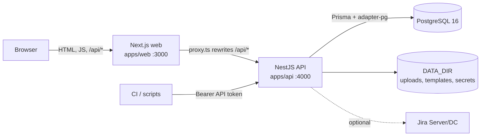
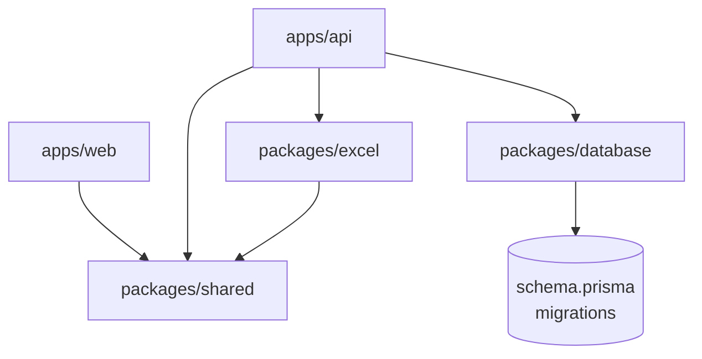
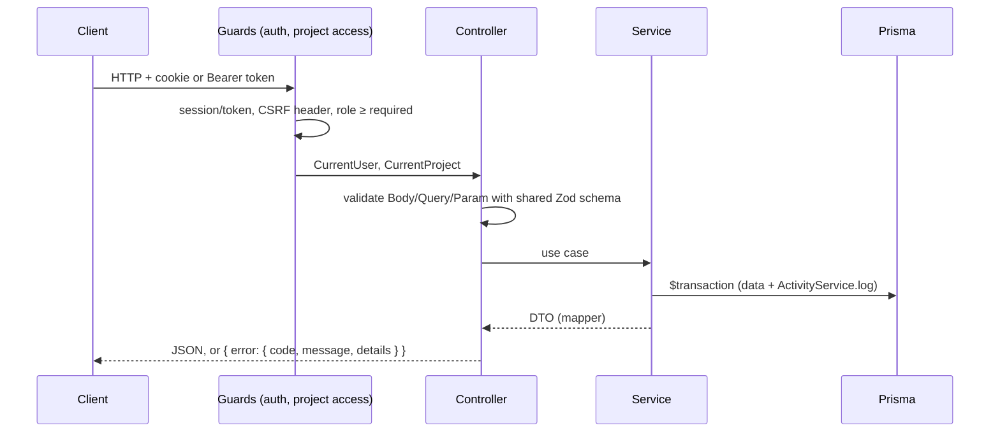
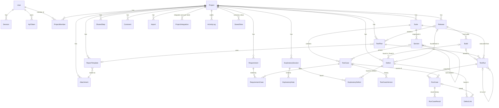

# Architecture

## System overview

- The browser only ever talks to the web app. `apps/web/src/proxy.ts` forwards `/api/*` to the API
  (`API_URL`, read at runtime) so the session cookie is first-party and no CORS is needed.
- Automation (CI, JUnit upload, scripts) calls the REST API directly with a personal API token.
- Everything stateful is in PostgreSQL (data) and `DATA_DIR` (uploaded files, generated secret).

## Workspaces and dependencies

| Workspace           | Responsibility                                                                     |
| ------------------- | ---------------------------------------------------------------------------------- |
| `packages/shared`   | Contract: enums, labels, Zod schemas, DTO types, permissions, pure domain logic    |
| `packages/database` | Prisma schema, SQL migrations, `createPrismaClient()`, table list for schema tests |
| `packages/excel`    | Reading/writing workbooks, CSV and JUnit parsing, template-based report generation |
| `apps/api`          | HTTP, authentication/authorisation, use cases, persistence, OpenAPI                |
| `apps/web`          | Pages, forms, data fetching, layout — no business rules that the API also enforces |

Dependencies point one way: apps → packages. Packages never import apps; `shared` imports nothing
from the others.

## API structure (`apps/api/src`)

| Folder                                             | Content                                                                                                   |
| -------------------------------------------------- | --------------------------------------------------------------------------------------------------------- |
| `common/`                                          | decorators (`@ProjectPermission`, `@AdminOnly`, `@SessionOnly`), guards, error filter, CSRF, rate limiter |
| `config/`                                          | `env.schema.ts` (Zod) and the typed `AppConfig`                                                           |
| `prisma/`                                          | `PrismaService` (single client)                                                                           |
| `modules/auth`, `users`                            | sign-in, sessions, password change, API tokens, user administration                                       |
| `modules/projects`                                 | projects, members, roles, project settings, releases and their builds                                     |
| `modules/library`                                  | suites, sections, test cases, versions, review workflow, shared steps                                     |
| `modules/imports`                                  | Excel import wizard (preview, dry run, commit), JUnit import                                              |
| `modules/execution`                                | plans, runs, run cases, results, history, bulk actions                                                    |
| `modules/defects`                                  | defects, links to run cases, workflow transitions                                                         |
| `modules/templates`                                | report templates (upload, check, default)                                                                 |
| `modules/reports`                                  | run report, plan/run Excel export, trend, summary by dimensions (+ saved views), reopens, schedule        |
| `modules/reports` (`traceability`, `compare`)      | requirement → case → result → defect table; comparison of two runs or builds                              |
| `modules/dimensions`                               | environment dimension lists of a project (Platform → OS ver / Mobile model), stored with the project      |
| `modules/requirements`                             | requirements table, Excel import, read-only Jira import/refresh, links to cases                           |
| `modules/sessions`                                 | exploratory sessions: charter, time box, notes timeline, linked defects                                   |
| `modules/dashboard`                                | release overview, results per build, release readiness, waiting-for-retest queue                          |
| `modules/topics`                                   | progress by topic → suite → run in a release (whole team or one person), handing suites to a person       |
| `modules/my-work`                                  | cases waiting for the signed-in user and a day/week summary of their results                              |
| `modules/notifications`                            | in-app notifications: assignment, due soon / overdue, retest, changed requirement                         |
| `modules/devices`                                  | test device registry (units, phones, routers) with check-out / return                                     |
| `modules/stands`                                   | lab test stands (not per project): zones, stands, bookings, install requests, stand sheet import          |
| `modules/collab`                                   | comments, attachments                                                                                     |
| `modules/integrations`                             | Jira settings and client                                                                                  |
| `modules/automation`                               | JUnit XML upload for CI                                                                                   |
| `modules/activity`, `storage`, `openapi`, `health` | audit log, file storage, OpenAPI document, health check                                                   |

Request flow:

Errors always have the same shape, with a stable `UPPER_SNAKE` code that the web maps to field
messages or toasts.

The OpenAPI document (`/api/v1/openapi.json`, Swagger UI at `/api/docs`) is generated from the
controllers and the shared Zod schemas, then completed with human-written titles, sections and
success responses from `modules/openapi/route-docs.ts`. The "REST API" page of the web app renders
that document, so the reference can never drift from the code.

## Web structure (`apps/web/src`)

`app/` holds routes only (`page.tsx` renders one feature component), `features/<feature>/` holds the
pages and their components, `components/ui` the shadcn/ui primitives, `components/common` shared
building blocks, `lib/api` the REST client with one React Query hook set per resource, and
`providers/` auth, project and query providers. See [conventions.md](conventions.md).

## Data model

Authorisation roles per project: `viewer < manager < tester < lead` (a manager sees the Team page and hands out topics like a lead, but cannot record results); administrators manage users and can see
every project. The ERD shows ownership (a project owns its data); optional "created by / assigned
to" links to `User` are omitted for readability.

How the team's words map to the model:

| Team wording                             | In the tool                                                         |
| ---------------------------------------- | ------------------------------------------------------------------- |
| Product / project (e.g. "Smart control") | Project                                                             |
| Step (e.g. 1.1.7, 1.1.8)                 | Release                                                             |
| Application build (e.g. `1.1.7(2.0.0)`)  | Build, listed under its release; chosen on each run                 |
| Test topic (system test, modbus test, …) | Suite                                                               |
| Test report document                     | Test plan (belongs to one release)                                  |
| One device / configuration               | Run (Test ID) with its environment entries (model, firmware, phone) |

Reports added later, all computed on request (no stored aggregates):

- **Summary** counts the run cases of the runs in scope by environment dimension (Platform, OS ver,
  Mobile model, App version, Unit model, FW version, Router …) and the built-ins topic / release /
  build. One run is one environment, so every run case counts once, in the cell of its run. Views
  (rows, columns, filters) can be saved per user or shared with the project (`saved_views`).
- **Traceability** joins requirements, the cases that test them and the latest results and defects.
  A case counts for a requirement when it is linked in the table (`requirement_cases`) or writes the
  key in its References text (key spellings such as `req 1` and `REQ-1` are the same key). Deleted,
  deprecated and archived cases do not count. Requirements come from Excel/CSV (column mapping,
  preview, one transaction), from Jira (read only: by issue keys or JQL, refreshed on demand; Jira is
  the authority for the title, description and status of those requirements) or are typed in.
  PDF and meeting-minutes sources are kept as a text reference (`source_ref`) only.
- **Compare** shows, per library case, the result on two runs or the latest result on two builds and
  what changed (a case that passed and now fails is a regression).
- **Schedule** (Gantt) places plans and runs on their planned dates (plan start/due, run due date),
  by topic or person.
- **Reopens** counts how often a defect was reopened from the activity log (entity `defect`, to =
  `reopened`), by release, build, platform and topic, and lists defects reopened twice or more.
- **Exploratory sessions** (`exploratory_sessions`, notes, linked defects) are unscripted, time-boxed
  testing with a charter; they belong to a release and optionally a build and can cite requirements
  in their references.
- **Requirement changes.** When the title or description of a requirement changes (edit, Excel
  re-import, Jira refresh) it is flagged `needsReview` (`text_changed_at` later than `reviewed_at`)
  until someone confirms the cases are still right; the testers of open runs that contain those
  cases are notified. A change of the source document alone does not flag.
- **Notifications** (`notifications`) are per user and project, created by the events above plus
  run assignment, a topic handed out and a defect set to resolved (retest). Due dates have no
  scheduler: due soon (2 days) and overdue are noticed when the user lists notifications, once per
  run and due date (`dedupe_key`). In-app only; there is no e-mail.
- **Devices** (`devices`) are the physical units, phones and routers of a project. A device is held
  exactly when it is `in_use` (database check constraint); taking one is a conditional update, so
  two people cannot both get it; the holder or a lead returns it; a held device cannot be sent to
  repair.
- **Test stands** (`stand_zones`, `stands`, `stand_bookings`, `stand_requests`) belong to the lab,
  not to a project. Bookings of one stand may not overlap (checked under a row lock on the stand,
  409 `STAND_BOOKED`). A request goes requested → accepted (with the day the technician will do it)
  → done, or is rejected (reason) or cancelled; done writes the requested model to the stand.
  Each step notifies the other side with a lab-wide notification (`notifications.project_id`
  null). Users with `is_technician` pass the auth guard only on routes marked `@TechnicianAllowed`
  and cannot be project members, so they never see test cases.
- **Evidence uploads** stream to `DATA_DIR/tmp/uploads` (hashed on the way) and are renamed into
  storage, up to `MAX_ATTACHMENT_MB`. The web forwards them with a route handler under `/upload`
  instead of the `/api` proxy, which would hold the body in memory.
- **Report template tables.** Besides `runs`, `cases` and `envList`, any sheet of a template can
  repeat rows for `${table:requirements.*}` (requirements that the plan's case rows test, by link
  or by citing the key, with their results and open defects), `${table:dimensions.*}` (results by
  environment label value and build) and `${table:sessions.*}` (exploratory sessions of the plan's
  release). They are built from the run snapshots and the project's requirements and sessions.
- **Language.** The side menu and page titles can be shown in Thai (account menu); the wording
  lives in `apps/web/src/lib/i18n/th.ts`, text that is not listed stays as it is.

A run may name a build of its plan's release (422 `BAD_BUILD` otherwise). Defects take a
"found in" and a "fixed in" build; a defect reported from a result starts with the build of that
run. A build that runs or defects use cannot be deleted (409 `BUILD_IN_USE`).

Design rules behind the model (details in the ADRs):

- **Run cases are snapshots** of the library case at the time the run is created, so editing the
  library never rewrites history; every result change is appended to `RunCaseResult` (ADR-003).
- **Deleting a project cascades** to everything it owns; references to users use `SET NULL` so
  removing an account keeps the audit trail; a suite used by a run cannot be deleted (`RESTRICT`).
- **Custom fields** of a suite are stored as JSONB on the case and described by the suite's
  field definitions (ADR-005).
- **Document numbers** of plans follow a per-project pattern (`{YY}TR-…-{MM}-{SEQ}`) and are unique
  per project.
- **Secrets** (Jira token) are sealed with AES-256-GCM; passwords use scrypt; session and API
  tokens are stored only as SHA-256 hashes (ADR-004, 007, 008).

## Testing strategy

| Level      | Tool                           | Scope                                                         |
| ---------- | ------------------------------ | ------------------------------------------------------------- |
| Unit (API) | Jest + `createPrismaMock()`    | services, guards, mappers, pure helpers                       |
| Unit (web) | Jest + Testing Library + jsdom | pages and components against a stubbed `fetch`                |
| Contract   | Jest (`packages/database`)     | schema contains the expected tables/columns                   |
| End to end | Jest + supertest + PostgreSQL  | HTTP → database for every module, permissions and error codes |
